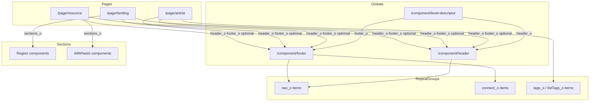

# Content model

## Hierarchy

- `/component/level-descriptor` inherits `header_o` and `footer_o` into pages.
- `/page/landing` renders `header_o`, then `sections_o`, then `footer_o`.
- Each region is its own component type, listed in `components.md`.
- `/page/article` stores author copy in `body_html` (`rte`). Card fields feed the blog index and home preview.
- `/page/resource` renders AltWheels regions from `sections_o`.

## Statistics

| Category | Count |
|----------|------:|
| Page types | 3 |
| Global components | 3 (level descriptor, header, footer) |
| Section components | 35 types, 41 content items |
| Item content types | 0 (repeat groups instead) |
| Landing pages | 7 |
| Article pages | 5 |
| Resource pages | 3 |
| Shared headers | 2 |
| Shared footers | 4 |
